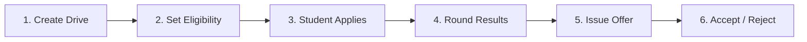
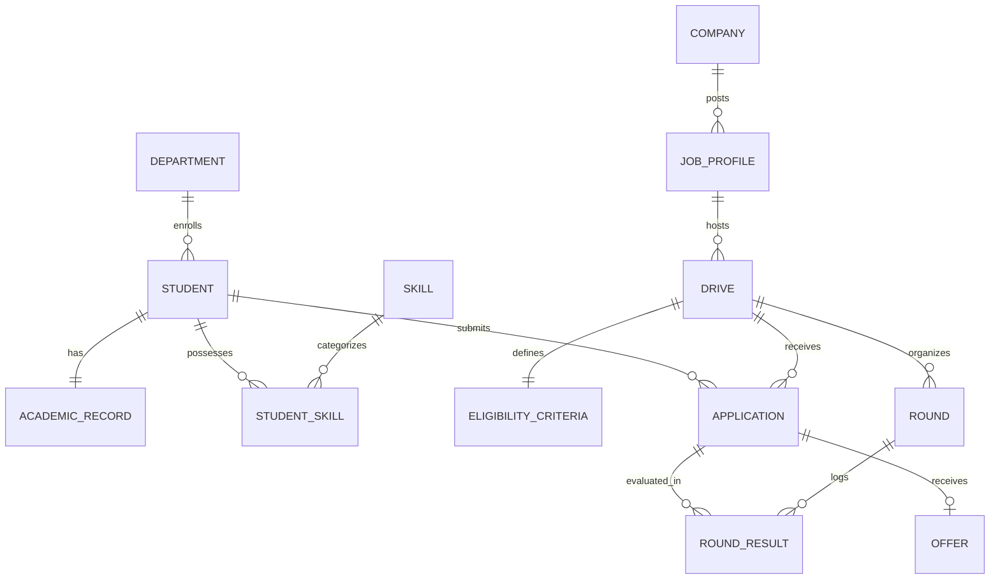

# PROJECT 22: Campus Placement & Recruitment Drive Management System 🎓

> **A database system for managing students, companies, drives, applications, and offers**  
> *Campus Placement System | DBMS Project 22*  
> **PowerPoint Presentation File:** [`Project_22_Campus_Placement_System.pptx`](./Project_22_Campus_Placement_System.pptx)

---

## 📑 Slide Deck Overview



---

### Slide 1: Title Slide
- **Project Title:** PROJECT 22 — Campus Placement & Recruitment Drive Management System
- **Subtitle:** A database system for managing students, companies, drives, applications and offers
- **Scope:** End-to-end recruitment lifecycle from student registration to final offer letter.

---

### Slide 2: Problem Statement
Most college placement cells still run on spreadsheets, emails, and manual checks. That creates real problems every placement season:
1. **Ineligible students apply:** No automatic CGPA, backlog, or percentage checks before application.
2. **Duplicate applications:** The same student can apply more than once for the same drive.
3. **Rounds get lost:** Aptitude, technical, and HR results live in different disconnected sheets.
4. **Offers are hard to track:** Who got an offer? Did they accept? No single place to look.
5. **Reports take too long:** Department-wise or company-wise numbers mean hours of manual work.
6. **Data becomes unreliable:** One accidental edit and the whole record set breaks.

---

### Slide 3: Why This System
We need one centralized place where the placement process is controlled, consistent, and easy to report on.
- **01. Stop Ineligible Applications:** Eligibility is automatically verified before a student can apply.
- **02. One Application Per Drive:** Database-level unique constraint blocks duplicate submissions.
- **03. Clear Round History:** Every Pass / Fail outcome is stored against the right application in order.
- **04. Single Source for Offers:** Issue, accept, or reject — all recorded in one place.
- **05. Fast Reports:** Department and company statistics in seconds, not hours.
- **06. Clean Data:** Foreign keys, checks, and constraints guarantee data integrity.

---

### Slide 4: Project Objectives
1. Identify domain entities, attributes, relationships, and user roles.
2. Design a clear ER model covering students, companies, drives, applications, rounds, and offers.
3. Convert the ER model into a relational schema and normalize it to 3NF.
4. Add integrity constraints so business rules are strictly enforced by the database.
5. Load realistic sample data and write useful SQL analytical reports.
6. Build a functioning web application and Python backend for drive setup, eligibility check, applications, rounds, and offers.

---

### Slide 5: Users of the System
| User Role | Main Responsibilities |
| :--- | :--- |
| **Placement Officer** | Create drives, set eligibility, enter round results, issue offers, generate reports |
| **Student / Candidate** | View eligible drives, apply, track round status, accept or reject offers |
| **Department Coordinator** | View department-wise placement statistics and eligible student percentages |
| **Company Recruiter** | View applicant profiles, evaluate candidates, submit shortlists, and confirm selections |

---

### Slide 6: Main Functions
1. **Drive Setup:** Create a drive linked to a company job profile and set eligibility rules.
2. **Eligibility Check:** Automated verification of CGPA, backlogs, and percentages before allowing applications.
3. **Application Processing:** Students apply to a drive with duplicate prevention.
4. **Round Management:** Define ordered rounds (Aptitude, Tech, HR) and record Pass / Fail / Pending.
5. **Offer Handling:** Issue offer letters; students accept or reject them.
6. **Reporting:** Eligible lists, drive applicant stats, department analytics, and company outcomes.

---

### Slide 7: Process Flow
```
[1. Create Drive] ➔ [2. Set Eligibility] ➔ [3. Student Applies] ➔ [4. Round Results] ➔ [5. Issue Offer] ➔ [6. Accept / Reject]
```
- **Steps 1–2:** Placement officer creates the drive and defines min CGPA, max backlogs, min 10th/12th percentages.
- **Step 3:** Student applies only if eligible. The system blocks duplicate applications for the same drive.
- **Step 4:** Officer/recruiter records round results (Pass / Fail) sequentially.
- **Steps 5–6:** Offer is issued (one per application). Student accepts or rejects. Status is updated.

---

### Slide 8: ER Diagram (13 Main Entities)



#### Core Relational Cardinalities:
- `Dept 1:N Student`
- `Student 1:1 AcademicRecord`
- `Student M:N Skill` (via `Student_Skill`)
- `Company 1:N JobProfile`
- `JobProfile 1:N Drive`
- `Drive 1:1 EligibilityCriteria`
- `Student M:N Drive` (via `Application`)
- `Drive 1:N Round`
- `Application 1:N RoundResult`
- `Application 1:1 Offer`

---

### Slide 9: Main Entities & Attributes
| Entity | What it Represents | Key Attributes |
| :--- | :--- | :--- |
| **Student** | Candidate for placement | `student_id`, `roll_no`, `name`, `email`, `dept_id`, `gender` |
| **Academic_Record** | Marks and performance | `student_id`, `cgpa`, `tenth_pct`, `twelfth_pct`, `backlogs` |
| **Company** | Recruiting organization | `company_id`, `name`, `industry`, `website`, `hr_email` |
| **Job_Profile** | A specific job opening | `job_id`, `company_id`, `title`, `type`, `package_lpa`, `location` |
| **Drive** | Campus recruitment event | `drive_id`, `job_id`, `date`, `venue`, `status` |
| **Eligibility_Criteria** | Who can apply | `drive_id`, `min_cgpa`, `max_backlogs`, `min_tenth_pct`, `min_twelfth_pct` |
| **Application** | Student applied to drive | `application_id`, `student_id`, `drive_id`, `applied_on`, `status` |
| **Round / Result** | Selection stage outcome | `round_id`, `sequence_no`, `application_id`, `result`, `score` |
| **Offer** | Final job offer | `offer_id`, `application_id`, `package_lpa`, `status`, `accepted_on` |

---

### Slide 10: Relational Schema & Constraints
| Table Name | Primary Key | Important Relationships & Constraints |
| :--- | :--- | :--- |
| **Department** | `dept_id` | Referenced by `Student.dept_id` |
| **Student** | `student_id` | FK → `Department(dept_id)`; `UNIQUE(roll_no)`, `UNIQUE(email)` |
| **Academic_Record** | `student_id` | 1:1 with `Student`; FK → `Student(student_id)` |
| **Skill / Student_Skill** | `skill_id` / composite | M:N between `Student` and `Skill` |
| **Company** | `company_id` | Referenced by `Job_Profile(company_id)` |
| **Job_Profile** | `job_id` | FK → `Company(company_id)` |
| **Drive** | `drive_id` | FK → `Job_Profile(job_id)` |
| **Eligibility_Criteria** | `drive_id` | 1:1 with `Drive`; FK → `Drive(drive_id)` |
| **Application** | `application_id` | FK → `Student`, `Drive`; `UNIQUE(student_id, drive_id)` |
| **Round** | `round_id` | FK → `Drive(drive_id)`; `UNIQUE(drive_id, sequence_no)` |
| **Round_Result** | `result_id` | FK → `Application(app_id)`, `Round(round_id)` |
| **Offer** | `offer_id` | FK → `Application`; `UNIQUE(application_id)` |

---

### Slide 11: Business Rules & Enforcement
| Rule | How It Is Enforced in Database Engine |
| :--- | :--- |
| **One application per student per drive** | `UNIQUE (student_id, drive_id)` on `Application` table |
| **No duplicate offers** | `UNIQUE (application_id)` on `Offer` table |
| **Valid CGPA (0.0 – 10.0)** | `CHECK (cgpa >= 0.0 AND cgpa <= 10.0)` on `Academic_Record` |
| **Valid percentages & non-negative backlogs** | `CHECK (tenth_pct BETWEEN 0 AND 100)` & `CHECK (backlogs >= 0)` |
| **Round sequence is strictly ordered** | `CHECK (sequence_no > 0)` + `UNIQUE(drive_id, sequence_no)` on `Round` |
| **Only valid status values permitted** | `CHECK (status IN ('Applied', 'Pass', 'Fail', 'Offered', 'Accepted'))` |
| **Eligibility verified prior to apply** | Enforced in SQL View + application trigger logic before `INSERT` |
| **Referential integrity** | Foreign keys with explicit `ON DELETE CASCADE / RESTRICT` policies |

---

### Slide 12: Conclusion & Future Scope
#### Deliverables Completed:
- Full problem statement, scope, and objectives.
- 13-entity ER model with cardinalities and constraints.
- Normalized 3NF relational schema.
- SQLite database (`.db/campusconnect.db`) with DB Browser support.
- Working web application for Students, Recruiters, and Placement Officers.

#### Future Enhancements:
- Email/SMS notification alerts for newly scheduled rounds and offers.
- AI-assisted candidate shortlisting based on resume skills.
- Direct enterprise recruiter portal integration.
- Cross-department historical placement analytics dashboards.

---
*Hackathon & DBMS Submission | Project 22*
